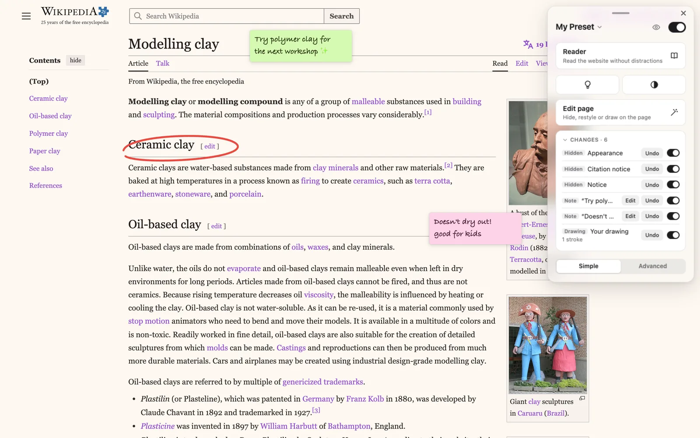

# Pagic

**Make the internet yours again.**

Pagic is a browser extension that lets you recolor, declutter and rearrange any
website, and remembers it every time you come back.

- **Recolor any site:** any colors, dark mode, your own font.
- **Hide the clutter:** click a sidebar, a banner or the comments, and it's gone for good.
- **Just read:** Reader turns any article into a clean page.
- **Notes on any page:** sticky notes and drawings that stay where you put them.
- **Remembers every site:** your changes are saved per site and come back on every visit.
- **Stays with you:** no account, and everything stays in your browser.

Starts simple, with more one switch away when you want it.

**[pagic.dev](https://pagic.dev)** · [Privacy](https://pagic.dev/privacy.html)

This repository is the website at pagic.dev.
